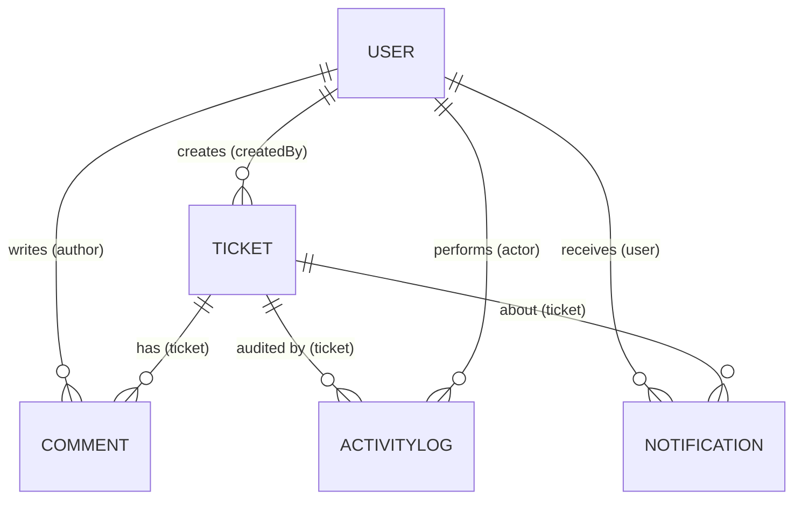

# Database Design

MongoDB (Mongoose ODM). Five collections. References are used between collections (not deep embedding) because
comments and logs grow without bound and are queried independently of the ticket.

## Collections

### users
| Field | Type | Notes |
|---|---|---|
| `_id` | ObjectId | |
| `name` | String | 2–60 chars |
| `email` | String | **unique**, lower-cased |
| `password` | String | bcrypt hash, `select: false` |
| `role` | `'user' \| 'admin'` | default `user` |
| `createdAt / updatedAt` | Date | |

### tickets
| Field | Type | Notes |
|---|---|---|
| `title` | String | 3–120 chars |
| `description` | String | 10–5000 chars |
| `category` | enum | technical, billing, account, feature_request, general, other |
| `priority` | enum | low, medium, high, urgent |
| `status` | enum | open, in_progress, resolved, closed |
| `createdBy` | ObjectId → users | owner |
| `resolvedAt`, `closedAt` | Date | set by status transitions; used for "avg. hours to resolve" |
| `createdAt / updatedAt` | Date | |

### comments
`ticket` (→ tickets), `author` (→ users), `authorRole` (snapshot of the role when written – drives the "Support team" badge), `message` (1–2000), timestamps.

### activitylogs  *(append-only audit trail written by the event handlers)*
`ticket`, `ticketTitle` (denormalised so the log stays readable after a ticket is deleted), `actor`, `actorName`, `actorRole`, `event`, `message`, `meta` (e.g. `{ priority: {from, to} }`), `createdAt`.

### notifications
`user` (recipient), `ticket`, `event`, `message`, `read` (bool), `createdAt`.

## Indexes and the query each one serves

| Collection | Index | Serves |
|---|---|---|
| users | `{ email: 1 }` unique | login, duplicate check |
| tickets | `{ createdBy: 1, status: 1, createdAt: -1 }` | "My tickets" with/without status filter, newest first |
| tickets | `{ status: 1, priority: 1, createdAt: -1 }` | admin queue filtered by status + priority |
| comments | `{ ticket: 1, createdAt: 1 }` | load a ticket's thread in order |
| activitylogs | `{ ticket: 1, createdAt: -1 }` | per-ticket timeline |
| activitylogs | `{ createdAt: -1 }` | global admin activity feed |
| notifications | `{ user: 1, read: 1, createdAt: -1 }` | bell list + unread count |

## Design decisions
- **Reference, don't embed comments** – unbounded growth, independent pagination, avoids the 16 MB document limit.
- **Denormalised snapshots** (`authorRole`, `ticketTitle`, `actorName`) – history stays correct when roles change or tickets are deleted.
- **Cascade rules (application level):** deleting a ticket deletes its comments; activity logs are intentionally retained for audit.
- **Validation in two layers:** Zod at the API boundary (friendly errors) and Mongoose schema constraints as a last line of defence.
- **Search** uses an escaped, case-insensitive regex on title/description – fine at this scale; a MongoDB text index or Atlas Search is the next step for large datasets.
- **Stats** are computed with a single `$facet` aggregation (one round-trip for all dashboard numbers).
